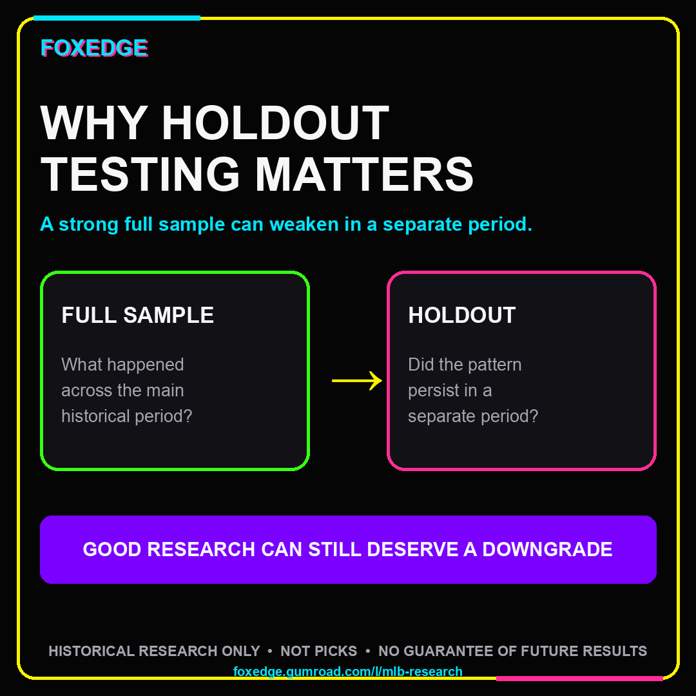
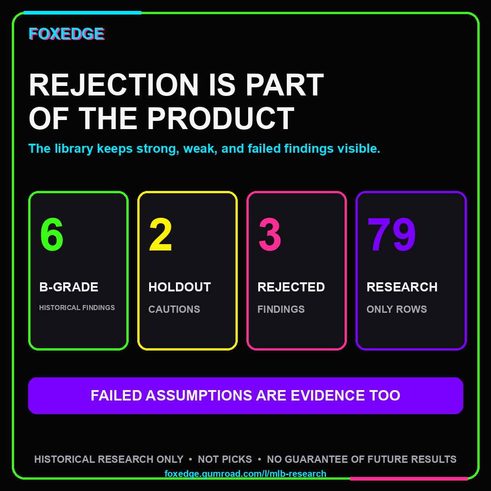
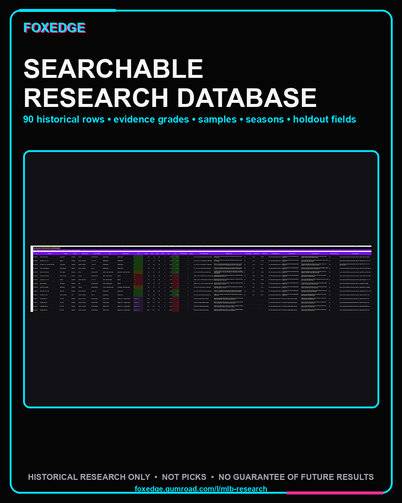
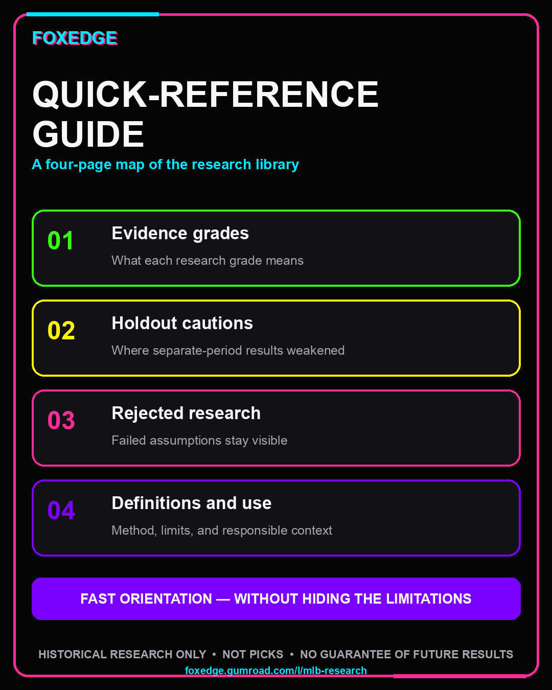

# FoxEdge MLB Historical Research Library - Free Sample

This sample shows how FoxEdge organizes historical MLB betting research: full-sample results, separate recent calendar tests, evidence grades, failed findings, live-context checks, and exact source locators.

It is a research preview, not a picks service, prediction model, or automatic betting system. Historical performance does not guarantee future results.

**[Download the designed seven-page sample (PDF)](FoxEdge_MLB_Historical_Research_Free_Sample.pdf)** or continue below for the accessible web version.

## What was studied

- 13,661 completed MLB games and 27,322 team-side opportunities from 2021 through July 12, 2026.
- Closing prices for the validated outcome work, using flat one-unit returns.
- A 2021-2026 partial full sample kept separate from the supplied 2025-2026 calendar test split.
- 90 documented situations: 6 B-grade historical monitors, 2 downgraded cautions, 3 rejected findings, and 79 research-only screens with no supplied report-card holdout.
- Season-level stability, bootstrap intervals, recent-test fields, context warnings, source row locators, and field-level source hashes where supplied.

The separation matters. A positive full sample can weaken in a later period, so FoxEdge does not turn every positive historical row into a recommendation.

## Evidence labels

| Label | Plain-language meaning | How it is used |
|---|---|---|
| B | Positive supplied recent calendar test | Historical monitor that still requires the current price and live context |
| D | Negative supplied recent calendar test | Downgraded caution |
| Reject | Supplied report-card rejection | Historical warning, never a recommendation |
| Research Only | Full-sample library row with no supplied report-card holdout | Narrative-checking and exploration only; not called validated |

## Representative findings

These are small examples copied from the paid library. They are not a combined portfolio or instructions to wager.

### Validated historical monitor: May dogs +120 to +129

| Evidence | Result |
|---|---|
| Full sample | 327 qualifying bets, 165-162, +41.30 units, +12.63% ROI, positive in 6 of 6 represented seasons |
| Supplied 2025-2026 calendar test | 107 bets, +10.81 units, +10.10% ROI |
| Grade | B - validated watch |
| Context gate | Do not use the month label alone. The current price, lineup, starter, bullpen, and market context still have to match. |

Source locator: `source_inputs/full_validation/34_angle_report_cards.csv | angle=May dogs +120 to +129`

### Downgraded finding: Detroit under 50% public

| Evidence | Result |
|---|---|
| Full sample | 459 qualifying bets, 214-245, +52.76 units, +11.49% ROI |
| Supplied 2025-2026 calendar test | 48 bets, -6.97 units, -14.53% ROI |
| Grade | D - caution; the recent test failed |
| Data warning | Public-side availability is incomplete in 2024-2026 and is source-coverage sensitive. |

This is why the library separates a positive-looking full sample from later evidence instead of promoting the headline number.

Source locator: `source_inputs/full_validation/34_angle_report_cards.csv | angle=Detroit under 50% public`

### Rejected finding: Colorado road moneyline

| Evidence | Result |
|---|---|
| Full sample | 448 qualifying bets, 129-319, -96.23 units, -21.48% ROI, positive in 0 of 6 represented seasons |
| Supplied 2025-2026 calendar test | 132 bets, -32.80 units, -24.85% ROI |
| Grade | Reject - historical warning |

Source locator: `source_inputs/full_validation/34_angle_report_cards.csv | angle=Colorado road moneyline`

## Database structure example

The companion workbook is designed for filtering rather than scrolling through isolated claims.

| ID | Situation | Category | Market | Price / threshold | Role | Grade | Full sample | Full units | Full ROI | Recent sample | Recent units | Recent ROI |
|---|---|---|---|---|---|---:|---:|---:|---:|---:|---:|---:|
| FE-MLB-003 | Favorites -120 to -139 under 50% public | Public support | Moneyline | -120 to -139 | Validated watch | B | 752 | +38.91 | +5.17% | 181 | +10.44 | +5.77% |

That row also carries profitable-season count, bootstrap interval, stability note, live-context check, public-data warning, source locator, and source hash fields in the full database.

## Quick-reference example

The four-page quick-reference guide groups findings by evidence status and ends with a live-board gate. A B-grade row is summarized like this:

| Situation | Grade | Full sample | Full units | Full ROI | Supplied recent test | Stability |
|---|---:|---:|---:|---:|---|---|
| July totals 10+ Under | B | 221 | +24.14 | +10.92% | 60 bets, +4.84 units, +8.07% ROI | Positive in 5 of 6 represented seasons |

Before any historical screen is considered relevant, the guide asks whether the current price, side, total, personnel, environment, market, and evidence label still match. If not, reject the spot.

## What the full $79 library contains

- A 51-page searchable playbook with all 90 situation cards, grade definitions, category sections, evidence notes, live-board checks, and exact source row locators.
- A 9-sheet Excel database with the full 90-row angle table, watchlist, cautions and fades, research-only screens, validated detail, season results, definitions, and a field-level source manifest.
- A four-page quick-reference PDF covering evidence grades, holdout cautions, rejected research, selected research-only narrative checks, definitions, and a live-board gate.
- A start-here guide and usage instructions.

The raw SQLite database and row-level canonical research extract are not included in the customer downloads.

## Important limits

- 2026 is partial through July 12.
- The validated outcome work uses closing prices; no validated opener, closing-line-value, or sportsbook-robustness analysis is claimed.
- Starting-pitcher fields are empty. Bullpen, weather, umpire, handle, travel-distance, and reliable public-vote timestamp fields were unavailable for the supplied historical work.
- Public-side coverage falls materially in 2024-2026.
- Historical grades describe the supplied evidence. They do not authorize a wager or predict a future result.

## Full library

[View the FoxEdge MLB Historical Research Library on Gumroad ($79)](https://foxedge.gumroad.com/l/mlb-research?utm_source=github&utm_medium=sample&utm_campaign=mlb-research-library&utm_content=controlled-free-sample)

Use only where legal and only with money you can afford to lose. If gambling is causing harm, stop and use the [National Council on Problem Gambling help resources](https://www.ncpgambling.org/help-treatment/) to find support.

FoxEdge is independent historical research. It does not accept wagers, place bets, or guarantee results.
